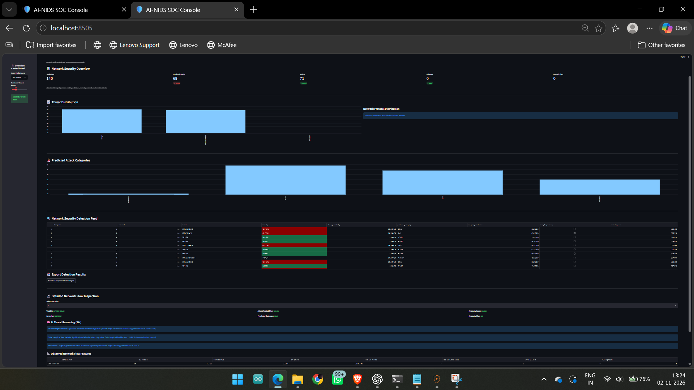
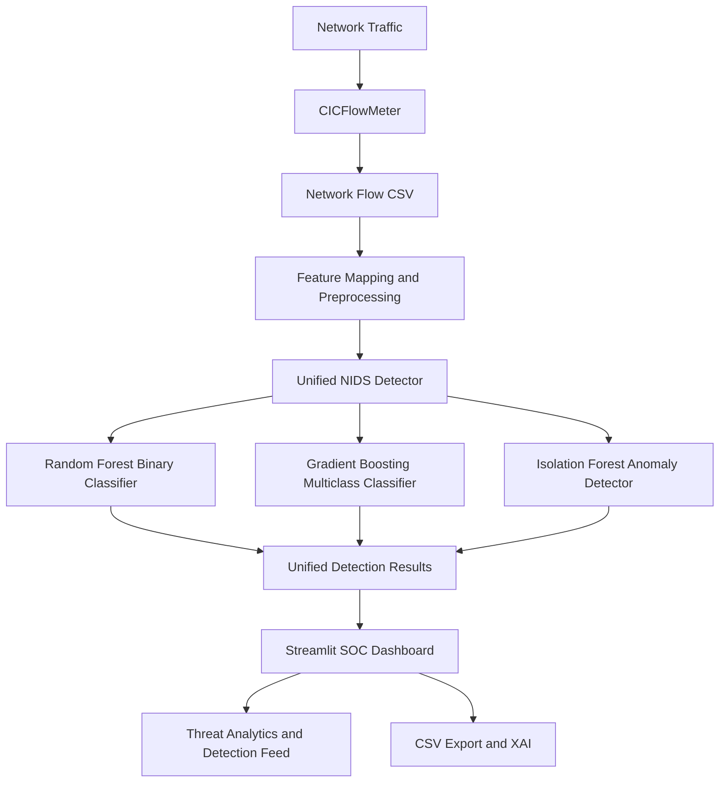

# 🛡️ AI-NIDS: AI-Powered Network Intrusion Detection System

An AI-powered Network Intrusion Detection System (AI-NIDS) designed to identify potentially malicious network traffic using machine learning, multiclass attack classification, anomaly detection, and an interactive Security Operations Center (SOC) dashboard.

The system uses network flow statistics extracted from network traffic and applies a hybrid machine learning approach to detect suspicious activity, classify attack categories, and identify potentially anomalous flows.

## Dashboard Preview




## System Architecture

The AI-NIDS system processes network traffic using CICFlowMeter,
prepares network flow features, and applies machine learning models
for binary detection, attack classification, and anomaly detection.




---

## 1. Project Overview

Traditional intrusion detection systems often rely on predefined signatures and rules to identify malicious network activities. Such approaches can struggle with previously unseen traffic patterns and evolving cyber threats.

AI-NIDS addresses this challenge by combining supervised and unsupervised machine learning techniques to analyze network traffic and identify potentially suspicious behaviour.

### Key Features

- **Binary Intrusion Detection:** Random Forest classifies network flows as BENIGN or ATTACK.
- **Multiclass Attack Classification:** Gradient Boosting predicts attack categories.
- **Anomaly Detection:** Isolation Forest identifies unusual network traffic patterns.
- **Network Flow Extraction:** CICFlowMeter extracts statistical features from captured network traffic.
- **Feature Preprocessing:** Converts extracted flow data into the format required by the trained models.
- **Explainable AI:** Provides feature-based explanations to support security analysis.
- **Interactive SOC Dashboard:** Streamlit dashboard displays traffic statistics, predictions, attack categories, and flow-level information.
- **Live Traffic Analysis:** Supports analysis of captured network traffic after flow extraction and preprocessing.

---

## 2. System Architecture

```text
          [ Network Traffic / PCAP ]
                     |
                     v
          [ CICFlowMeter ]
                     |
                     v
          [ Network Flow CSV ]
                     |
                     v
       [ Feature Conversion & Alignment ]
                     |
                     v
          [ Unified NIDS Detector ]
                     |
          +----------+----------+
          |          |          |
          v          v          v
       Random     Gradient   Isolation
       Forest     Boosting    Forest
       Binary     Multiclass  Anomaly
          |          |          |
          +----------+----------+
                     |
                     v
          [ Prediction & Verdict ]
                     |
                     v
             [ Explainability ]
                     |
                     v
           [ Streamlit SOC Dashboard ]
                     |
                     v
          [ Security Analysis & Reports ]
```

### Detection Components

| Component | Algorithm | Purpose |
|---|---|---|
| Binary detection | Random Forest | BENIGN vs ATTACK |
| Multiclass classification | Gradient Boosting | Attack category prediction |
| Anomaly detection | Isolation Forest | Unusual traffic identification |
| Explainability | Feature-based XAI | Supporting model interpretation |
| Dashboard | Streamlit | Visual security monitoring |

The binary Random Forest is the primary attack detection model. The multiclass model provides secondary attack-category predictions, while Isolation Forest provides additional anomaly information.

The current binary decision threshold is **0.05**.

---

## 3. Dataset and Preprocessing

### Dataset

The project uses the **CIC-IDS2017** network intrusion detection dataset.

It contains network traffic records representing benign activities and different categories of cyberattacks.

### Dataset Categories

- BENIGN
- DoS
- DDoS
- PortScan
- FTP-Patator
- SSH-Patator
- WebAttack
- Botnet
- Other represented attack categories

### Preprocessing Steps

1. Load the original CIC-IDS2017 CSV files.
2. Combine and inspect network flow records.
3. Handle missing and infinite values.
4. Remove duplicate records.
5. Prepare binary labels for intrusion detection.
6. Encode attack categories for multiclass classification.
7. Align the training features with the model's expected feature schema.
8. Prepare training, validation, and test datasets.
9. Save the processed datasets for model training and evaluation.

The final binary model uses **61 statistical network-flow features**.

The live-flow conversion pipeline also retains the Protocol field as metadata for supported-protocol handling.

---

## 4. Machine Learning Models

### A. Random Forest — Binary Classification

The Random Forest model is responsible for identifying whether a network flow is benign or potentially malicious.

Output:
- BENIGN
- ATTACK

The model uses a configured decision threshold of 0.05.

### B. Gradient Boosting — Multiclass Classification

The Gradient Boosting model provides a secondary prediction of the traffic category.

It helps identify the possible family of an attack, such as:

- BENIGN
- DoS
- DDoS
- PortScan
- BruteForce
- WebAttack
- Other represented categories

### C. Isolation Forest — Anomaly Detection

Isolation Forest is an unsupervised machine learning algorithm used to identify unusual traffic patterns.

It provides an additional anomaly signal that can support the investigation of potentially suspicious network flows.

An anomaly flag does not independently confirm that a flow is malicious or represents a zero-day attack.

---

## 5. Model Evaluation

The binary Random Forest model was evaluated on the prepared V3 test dataset.

### Binary Classification Performance

| Metric | Result |
|---|---:|
| Test samples | 182,036 |
| Accuracy | 99.5402% |
| Precision | 99.0931% |
| Recall | 99.9956% |
| F1-score | 99.5423% |
| ROC-AUC | 0.999980 |
| False Positive Rate | 0.9152% |

### Confusion Matrix

| Actual / Predicted | BENIGN | ATTACK |
|---|---:|---:|
| BENIGN | 90,185 | 833 |
| ATTACK | 4 | 91,014 |

The model achieved high recall on the prepared test dataset, detecting nearly all attack samples while producing some false-positive predictions.

**Important:** These metrics represent performance on the prepared CIC-IDS2017 test split. They should not be interpreted as guaranteed performance on arbitrary real-world network traffic.

The multiclass model and Isolation Forest provide additional classification and anomaly information. Their independent performance should be reported only when supported by their corresponding evaluation results.

---

## 6. Live Network Traffic Detection

AI-NIDS supports a live network traffic analysis workflow using CICFlowMeter.

### Workflow

1. Capture network traffic through a supported network interface.
2. Use CICFlowMeter to extract bidirectional network flows.
3. Generate flow-level statistical information.
4. Convert the extracted CSV into the model-compatible feature format.
5. Pass the converted flows to the unified detection engine.
6. Generate predictions and anomaly information.
7. Display the results in the SOC dashboard.
8. Export prediction results for further investigation.

### Latest Live-Capture Experiment

The latest processed capture contained 451 network flows.

| Result | Flow count |
|---|---:|
| Predicted attacks | 283 |
| Predicted benign | 56 |
| Unsupported protocol | 112 |
| **Total** | **451** |

Protocol distribution:

| Protocol | Flow count |
|---|---:|
| TCP (6) | 312 |
| UDP (17) | 27 |
| Protocol 0 | 112 |

The 112 Protocol 0 flows are treated as unsupported by the current detector.

### Live Prediction Analysis

Among the 283 predicted attacks:

- 281 were classified as `ATTACK (CATEGORY_UNCERTAIN)`.
- 1 was classified as `ATTACK (DoS)`.
- 1 was classified as `ATTACK (WebAttack)`.
- 5 were also flagged by Isolation Forest as anomalies.

The binary model and multiclass model showed disagreement on many live flows. Therefore, these predictions must be treated as potential alerts requiring investigation, not confirmed cyberattacks.

The live capture was not independently labelled with ground-truth attack information. Consequently, live accuracy and false-positive rate cannot be calculated from this experiment.

---

## 7. Interactive SOC Dashboard

The project includes a Streamlit-based dashboard for visualizing network traffic analysis and model predictions.

### Dashboard Features

- Total network flow statistics
- Predicted attack and benign counts
- Unsupported protocol statistics
- Anomaly detection information
- Traffic distribution visualizations
- Attack category distribution
- Security detection feed
- Flow-level inspection
- Model explanation information
- CSV prediction export

### Launch Dashboard

Activate the virtual environment:

```cmd
cd C:\Users\harsh\AI-NIDS
.\venv\Scripts\activate
```

Launch Streamlit:

```cmd
python -m streamlit run dashboard\app.py --server.port 8505
```

Open the dashboard in your browser:

```text
http://localhost:8505
```

The port can be changed if required.

---

## 8. Running Live Predictions

The project includes a script for generating predictions from the latest processed live capture.

Run:

```cmd
python generate_live_predictions.py
```

Input:

```text
reports/live_capture_03_v3.csv
```

Output:

```text
reports/live_capture_03_predictions.csv
```

The output contains:

- Flow index
- Detection verdict
- Severity
- Attack status
- Protocol
- Attack probability
- Benign probability
- Predicted category
- Category confidence
- Anomaly flag
- Anomaly score

---

## 9. Automated Testing

The project contains automated tests for attack detection and live inference.

Install pytest:

```cmd
python -m pip install pytest
```

Run the tests:

```cmd
python -m pytest tests -v
```

### Latest Test Results

| Test | Result |
|---|---|
| test_attack_detection.py | PASSED |
| test_live_inference.py | PASSED |
| Total tests | 2 |
| Passed | 2 |
| Failed | 0 |

These tests verify the implemented test cases. They do not guarantee detection of every possible attack or validate live-network accuracy.

---

## 10. Project Directory Structure

```text
AI-NIDS/
│
├── configs/
│   └── feature_schema.yaml
│
├── dashboard/
│   └── app.py
│
├── dataset/
│   ├── MachineLearningCVE/
│   └── processed/
│       └── prepared_v3/
│
├── detection/
│   └── unified_detector.py
│
├── explainability/
│   └── explainer.py
│
├── feature_extraction/
│   └── flow_extractor.py
│
├── models/
│   ├── random_forest_binary_v3.pkl
│   ├── random_forest_binary_v3_threshold.txt
│   ├── gradient_boost_multiclass.pkl
│   ├── isolation_forest_anomaly.pkl
│   └── class_labels.pkl
│
├── notebooks/
│
├── preprocessing/
│   └── cicflowmeter_to_v3.py
│
├── reports/
│   ├── final_model_evaluation.csv
│   ├── live_capture_03_v3.csv
│   └── live_capture_03_predictions.csv
│
├── tests/
│   ├── test_attack_detection.py
│   └── test_live_inference.py
│
├── tools/
│   └── CICFlowMeter_corrected/
│
├── generate_live_predictions.py
├── README.md
└── venv/
```

*Note: The directory listing above highlights the main project components. Additional diagnostic scripts, datasets, and model-support files may also be present.*

---

## 11. Limitations

The current implementation has several limitations that should be considered:

1. **Live false-positive validation:** Live predictions do not currently have independent ground-truth labels.
2. **Unsupported protocols:** Protocol values other than TCP (6) and UDP (17) are currently marked as unsupported.
3. **Model disagreement:** Binary and multiclass models may produce different predictions for the same flow.
4. **Dataset generalization:** High benchmark performance does not guarantee equivalent performance on different network environments.
5. **Zero-day detection:** Isolation Forest identifies anomalous patterns, but anomaly detection alone cannot prove the presence of a zero-day attack.
6. **Traffic processing:** The current dashboard analyzes captured flow datasets; it should not be described as a fully continuous, real-time streaming SOC platform.

---

## 12. Future Scope

Possible improvements include:

- Expanding support for additional network protocols.
- Reducing false-positive predictions through labelled real-world traffic