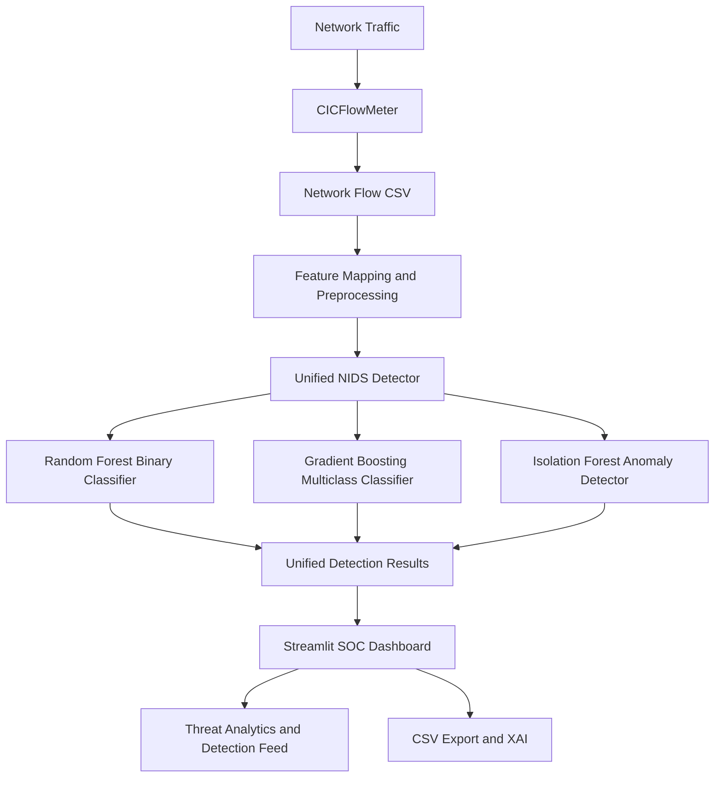

# 🛡️ AI-NIDS: AI-Powered Network Intrusion Detection System

An AI-powered Network Intrusion Detection System (AI-NIDS) designed to identify potentially malicious network traffic using machine learning, multiclass attack classification, anomaly detection, and an interactive Security Operations Center (SOC) dashboard.

The system uses network flow statistics extracted from network traffic and applies a hybrid machine learning approach to detect suspicious activity, classify attack categories, and identify potentially anomalous flows.

## Dashboard Preview


## System Architecture

The AI-NIDS system processes network traffic using CICFlowMeter, prepares network flow features, and applies machine learning models for binary detection, attack classification, and anomaly detection.



---

## 1. Project Overview

Traditional intrusion detection systems often rely on predefined signatures and rules to identify malicious network activities. Such approaches can struggle with previously unseen traffic patterns and evolving cyber threats.

AI-NIDS addresses this challenge by combining supervised and unsupervised machine learning techniques to analyze network traffic and identify potentially suspicious behaviour.

### Key Features

- **Binary Intrusion Detection:** Random Forest classifies network flows as BENIGN or ATTACK.
- **Multiclass Attack Classification:** Gradient Boosting predicts possible attack categories.
- **Anomaly Detection:** Isolation Forest identifies unusual network traffic patterns.
- **Network Flow Extraction:** CICFlowMeter extracts statistical features from captured network traffic.
- **Feature Preprocessing:** Converts extracted flow data into the format required by the trained models.
- **Explainable AI (XAI):** Provides feature-based explanations to support security analysis.
- **Interactive SOC Dashboard:** Streamlit dashboard displays traffic statistics, predictions, attack categories, and flow-level information.
- **Live Traffic Analysis:** Supports analysis of captured network traffic after flow extraction and preprocessing.

---

## 2. System Architecture

The system follows a machine learning-based network intrusion detection pipeline.

```text
          [ Network Traffic / PCAP ]
                     |
                     v
             [ CICFlowMeter ]
                     |
                     v
           [ Network Flow CSV ]
                     |
                     v
       [ Feature Conversion & Alignment ]
                     |
                     v
           [ Unified NIDS Detector ]
                     |
           +---------+---------+
           |         |         |
           v         v         v
        Random    Gradient  Isolation
        Forest    Boosting   Forest
        Binary    Multiclass Anomaly
           |         |         |
           +---------+---------+
                     |
                     v
           [ Prediction & Verdict ]
                     |
                     v
              [ Explainability ]
                     |
                     v
           [ Streamlit SOC Dashboard ]
                     |
                     v
          [ Security Analysis & Reports ]
```

### Detection Components

| Component | Algorithm | Purpose |
|---|---|---|
| Binary Detection | Random Forest | BENIGN vs ATTACK |
| Multiclass Classification | Gradient Boosting | Attack category prediction |
| Anomaly Detection | Isolation Forest | Unusual traffic identification |
| Explainability | Feature-based XAI | Supporting model interpretation |
| Dashboard | Streamlit | Visual security monitoring |

The binary Random Forest is the primary attack detection model. The multiclass model provides secondary attack-category predictions, while Isolation Forest provides additional anomaly information.

The current binary decision threshold is **0.05**.

---

## 3. Dataset and Preprocessing

### Dataset

The project uses the **CIC-IDS2017** network intrusion detection dataset.

It contains network traffic records representing benign activities and different categories of cyberattacks.

### Dataset Categories

- BENIGN
- DoS
- DDoS
- PortScan
- FTP-Patator
- SSH-Patator
- WebAttack
- Botnet
- Other represented attack categories

### Preprocessing Steps

1. Load the original CIC-IDS2017 CSV files.
2. Combine and inspect network flow records.
3. Handle missing and infinite values.
4. Remove duplicate records.
5. Prepare binary labels for intrusion detection.
6. Encode attack categories for multiclass classification.
7. Align the training features with the model's expected feature schema.
8. Prepare training, validation, and test datasets.
9. Save the processed datasets for model training and evaluation.

The final binary model uses **61 statistical network-flow features**.

The live-flow conversion pipeline also retains the Protocol field as metadata for supported-protocol handling.

---

## 4. Machine Learning Models

### A. Random Forest — Binary Classification

The Random Forest model is responsible for identifying whether a network flow is benign or potentially malicious.

**Output:**
- BENIGN
- ATTACK

The model uses a configured decision threshold of 0.05.

### B. Gradient Boosting — Multiclass Classification

The Gradient Boosting model provides a secondary prediction of the traffic category.

It helps identify the possible family of an attack, such as:

- BENIGN
- DoS
- DDoS
- PortScan
-